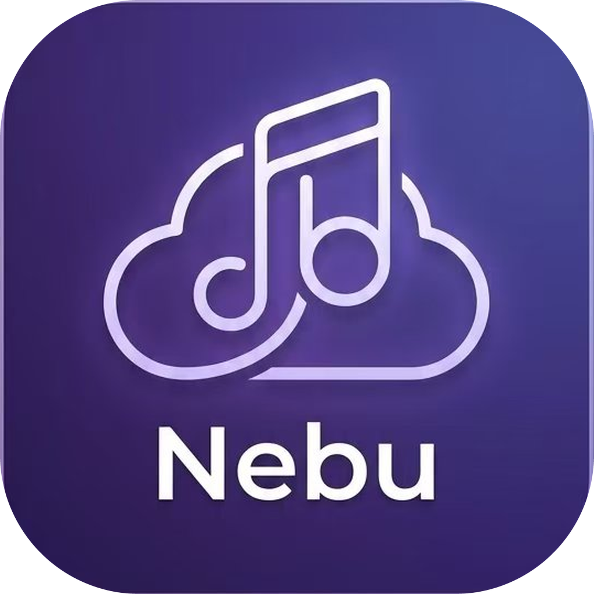
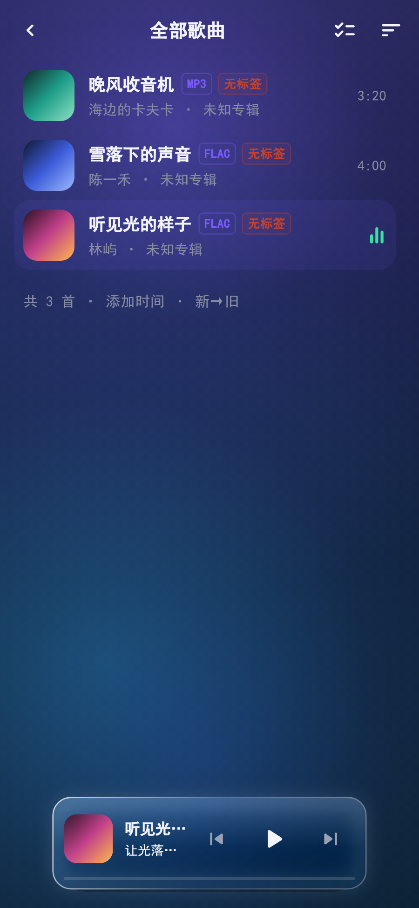
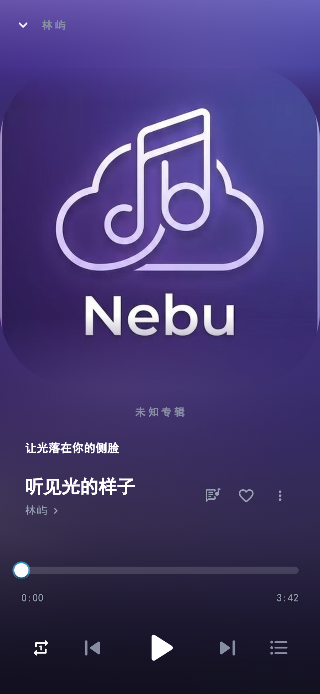
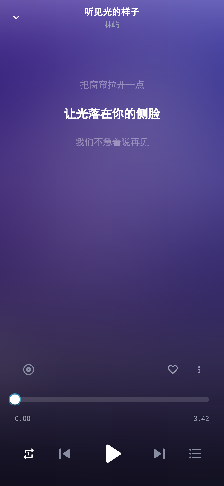
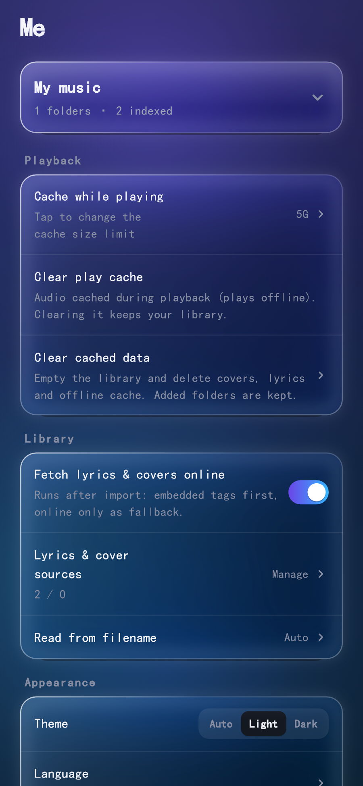
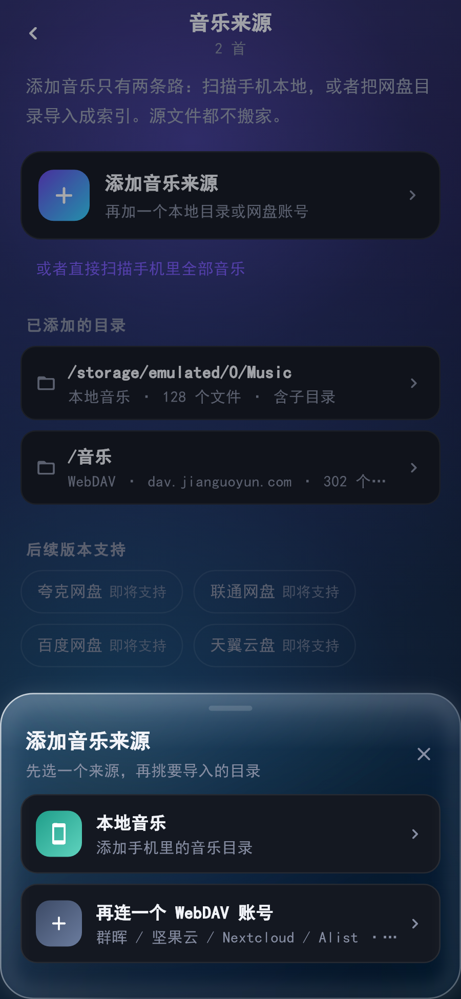

<div align="center">



# Nebu · 云听

**把网盘变成你的私人音乐库。**
一个用 Flutter 写的网盘音乐播放器，直连 WebDAV，不存服务器、不上传曲库、不插广告。

[](../../releases)
[](LICENSE)
[](#安装)
[](https://flutter.dev)
[](#开发)

[下载安装](#安装) · [功能](#功能) · [从源码构建](#从源码构建) · [常见问题](#常见问题) · [English](#english)

</div>

---

## 它是什么

你在群晖、坚果云、Nextcloud、Alist 里躺着的那些音乐，平时只能在电脑上听。Nebu 把这个库直接搬到手机上：填一个 WebDAV 地址，它帮你扫描目录、读出标签和封面、生成曲库，然后像本地播放器一样播放、收藏、建歌单。

**没有云端服务器**——所有请求都从你的手机直接打到你的网盘；账号密码存在系统钥匙串（Android Keystore / iOS Keychain），数据库里只有地址和用户名。

<div align="center">
<table>
<tr>
<td></td>
<td></td>
<td></td>
<td></td>
<td></td>
</tr>
<tr>
<td align="center"><sub>曲库 · 悬浮播放条</sub></td>
<td align="center"><sub>播放页 · 封面</sub></td>
<td align="center"><sub>播放页 · 歌词</sub></td>
<td align="center"><sub>我的 · 英文</sub></td>
<td align="center"><sub>添加音乐来源</sub></td>
</tr>
</table>
</div>

## 功能

**音乐来源**
- **WebDAV 直连**：群晖 / 坚果云 / Nextcloud / ownCloud / Alist / OpenList 均可，支持添加多个账号
- **本地音乐导入**：选一个目录全量扫描，读 ID3 / FLAC / MP4 标签与内嵌封面
- 同源同路径自动去重，重复扫描不会产生副本

**曲库与播放**
- 全部歌曲 / 专辑 / 歌手 / 歌单 / 收藏 / 最近播放，实时搜索过滤
- 边听边缓存，二次播放不重复走网络
- 歌词：优先读网盘同目录同名 `.lrc`，没有则在**在线歌词源**里按顺序补全
- 封面：读内嵌封面，缺失时可由**在线封面源**补全
- 播放页支持封面 / 歌词双视图，悬浮播放条常驻

**个性化**
- **7 种语言**：简体中文、繁體中文、English、日本語、한국어、བོད་ཡིག（藏文）、ئۇيغۇرچە（维吾尔语）；默认跟随系统语言
- **主题**：浅色 / 深色 / 跟随系统
- **下载到本地**：可指定保存目录（公共音乐目录 / 下载目录 / 应用私有目录）
- **文件名识别规则**：自定义「歌手 - 标题」的分隔符与字段顺序，冷门命名也能识别

**其他**
- 应用内检查更新（读 `version.json` 比对版本号）
- 在线补全源可自定义：兼容 LRCLIB 接口，或用模板地址（`{title}` `{artist}` `{album}` `{duration}` 占位）

## 安装

### Android

到 [Releases](../../releases/latest) 下载 `nebu-v0.0.001-release.apk` 直接安装（需要允许「安装未知来源应用」）。

- 最低支持 Android 8.0（API 26）
- 包名 `com.cloudtune.player`，使用项目自有密钥签名，签名一致的旧版本可直接覆盖升级

### iOS

仓库不提供 iOS 安装包（需苹果开发者账号与证书）。想装的话按[从源码构建](#从源码构建)里的 iOS 步骤自己出包。

## 从源码构建

需要 Flutter 3.x、Android SDK（含 command-line tools）、JDK 17。

```bash
git clone https://github.com/zhurui360-dot/nebu.git
cd nebu
flutter pub get
flutter test          # 141 个测试
flutter build apk --release
```

产物在 `build/app/outputs/flutter-apk/app-release.apk`。

**签名的坑**：仓库里没有签名文件（已被 `.gitignore` 排除）。没有 `android/key.properties` 时构建脚本会自动回退到 debug 签名，能装但无法覆盖升级官方包。要出正式包，自己生成一个：

```bash
keytool -genkey -v -keystore android/app/my-release.jks -keyalg RSA \
  -keysize 2048 -validity 10000 -alias mykey
```

再写 `android/key.properties`：

```properties
storePassword=你的store口令
keyPassword=你的key口令
keyAlias=mykey
storeFile=my-release.jks
```

**JDK 版本**：Gradle 需要 JDK 17。Windows 上先设 `JAVA_HOME` 再构建，别在 `cmd` 里拼反斜杠路径（容易被转义成 `//`）：

```powershell
$env:JAVA_HOME='C:\path\to\jdk-17'
flutter build apk --release
```

**iOS**：

```bash
cd ios && pod install && cd ..
flutter build ipa --release   # 需要 Xcode 与开发者证书
```

## 更新机制

App 启动时静默拉一次更新清单，和本地版本号比对（只比 `versionCode`），有新版本就在「我的」页标红点。

清单地址在 `lib/app_meta.dart` 的 `defaultUpdateUrl`，格式：

```json
{
  "version": "0.0.2",
  "versionCode": 2,
  "url": "https://github.com/zhurui360-dot/nebu/releases/download/v0.0.2/nebu-v0.0.2-release.apk",
  "size": 64725183,
  "force": false,
  "notes": ["这一版改了什么", "第二条"]
}
```

`versionCode` 由版本号第三段自动推导（`0.0.2` → `2`），不手填，避免漏改导致误报。想换成自己的发布源，把 `defaultUpdateUrl` 指向任意返回同结构 JSON 的地址即可。

## 项目结构

```
lib/
├─ main.dart              入口
├─ app.dart               MaterialApp、主题、多语言装配
├─ app_meta.dart          版本号与更新地址
├─ models/                Track / Playlist / CloudSource 等数据模型
├─ state/                 AppState（曲库、来源、设置）、PlayerState（播放）
├─ data/
│  ├─ db/                 sqflite 表结构与读写
│  ├─ repository.dart     SharedPreferences 偏好持久化
│  ├─ cloud/              WebDAV 客户端、云源抽象
│  └─ local/              本地目录扫描、标签解析
├─ services/              下载、缓存、在线歌词/封面补全
├─ l10n/                  7 语言字典与自定义 LocalizationsDelegate
├─ theme/                 色板、玻璃质感、圆角与模糊梯度
├─ screens/               首页 / 曲库 / 搜索 / 播放 / 我的 / 来源管理
└─ widgets/               玻璃卡片、各类弹层、通用行组件
test/                     单元测试与 UI 预览快照（141 个用例）
docs/                     截图与图标
```

## 开发

```bash
flutter analyze      # 0 error
flutter test         # 141 passed
```

测试覆盖：曲库索引与去重、歌单增删、删除歌曲的引用清理、多语言回退链、WebDAV 添加全链路（弹层串接）、主题与设置持久化。

## 常见问题

**Q：扫描完没有封面？**
封面读的是文件内嵌的 APIC / FLAC PICTURE / MP4 covr。纯音频无内嵌图时，需要在「我的 → 歌词源 / 封面源」里保留在线封面源。

**Q：检查更新一直提示已是最新？**
说明当前 `versionCode` 不小于清单里的值。自己改版本号发版时，`pubspec.yaml` 的 `version` 和 `lib/app_meta.dart` 的 `version` 必须同步改。

**Q：维吾尔语界面为什么没有从右往左排？**
维吾尔语已支持文字显示，但 RTL 镜像布局还没做，仍在路线图里。

## 路线图

- [ ] 维吾尔语 RTL 镜像布局
- [ ] 补齐长尾文案的多语言翻译（分类名、错误提示）
- [ ] Android Auto / 通知栏歌词
- [ ] 均衡器
- [ ] SMB / DLNA 来源

## 免责声明

本项目仅用于播放**你自己合法拥有或有权访问**的音乐文件。请勿用它下载、传播侵犯版权的内容。软件按 MIT 协议「原样」提供，作者不对使用后果承担责任。

## License

[MIT](LICENSE) © 2026 zhurui360-dot

---

<a id="english"></a>

<details>
<summary><b>English</b></summary>

**Nebu** is a Flutter music player that turns your WebDAV cloud drive (Synology, Jianguoyun, Nextcloud, Alist…) into a private music library. No backend, no uploads, no ads — your phone talks to your own drive directly, and credentials live in the system keystore.

- WebDAV with multiple accounts, plus local folder import with tag & cover parsing
- Library, albums, artists, playlists, favorites, recents, instant search
- Play while caching, `.lrc` lyrics from the same folder, online lyric/cover fallback
- 7 languages (zh-Hans, zh-Hant, en, ja, ko, bo, ug), light/dark/system themes
- Download to local with a configurable target folder, custom filename parsing rules
- In-app update check against a `version.json` manifest

Download the latest APK from [Releases](../../releases/latest). Build from source with `flutter build apk --release` (JDK 17 required).

Licensed under MIT. For personal media only — play content you own or have the right to access.

</details>
